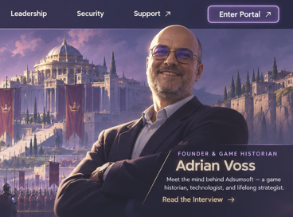
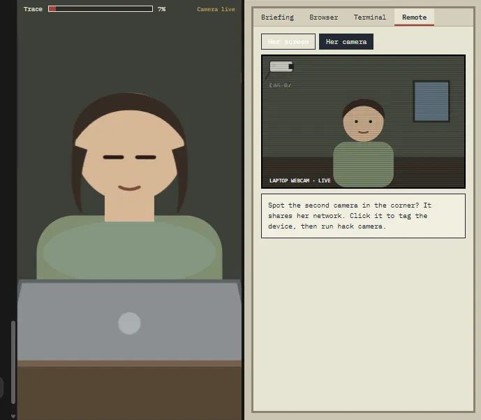
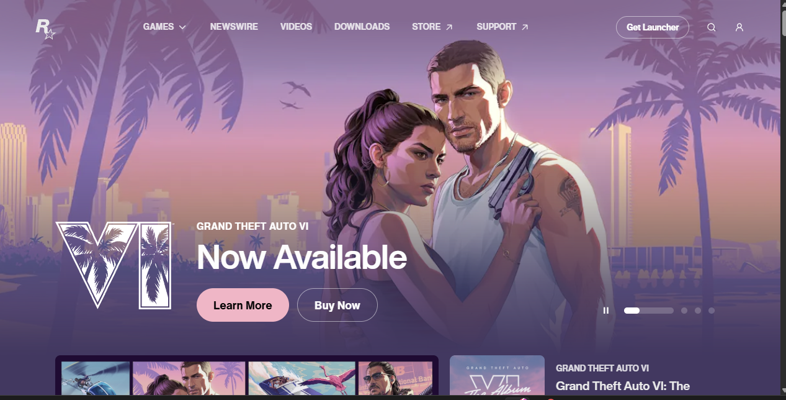
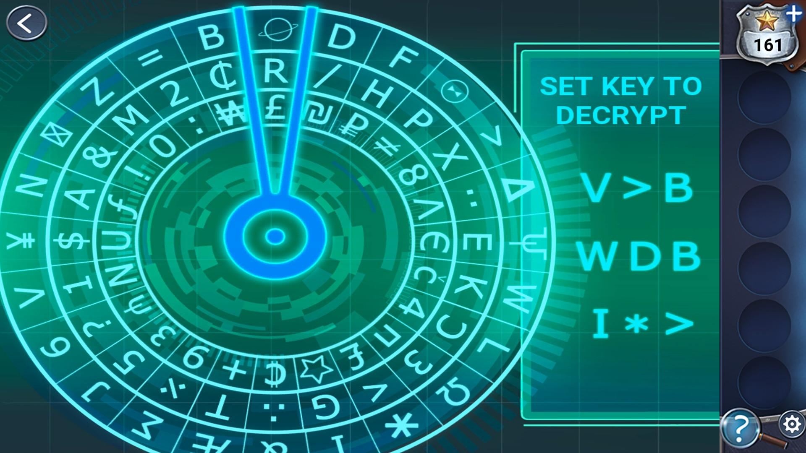
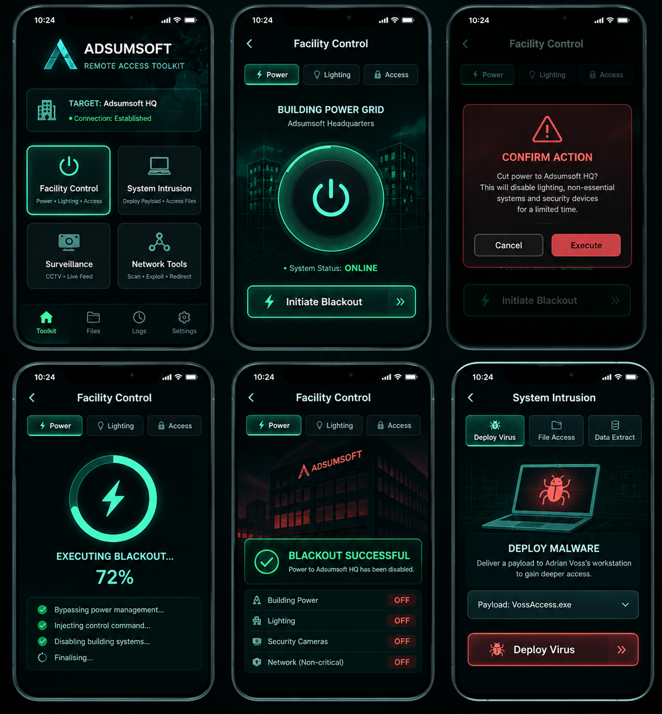

<div align="center">

# ⌁ ADSUMSOFT: OPERATION FALLEN EMPIRE


### `// ACCESS LEVEL: RECRUIT //`

**THREE BREACHES. ONE EMPIRE. NO SECOND CHANCES.**


`[ INITIATE BRIEFING ]` &nbsp; ` [ ENCRYPTED CHANNEL ] ` &nbsp; ` [ AUTHORIZATION REQUIRED ] `

---

*An interactive, story-driven cybersecurity puzzle game.*  
*Decode the message. Exploit the flaw. Expose the truth.*

</div>

```text
┌──────────────────────────────────────────────────────────────────┐
│  ENCRYPTED TRANSMISSION                             PRIORITY: 01 │
├──────────────────────────────────────────────────────────────────┤
│  TO:      NEW RECRUIT                                            │
│  FROM:    [REDACTED] / INVESTIGATIONS UNIT                       │
│  SUBJECT: OPERATION FALLEN EMPIRE                                │
│                                                                  │
│  Welcome, Agent.                                                 │
│                                                                  │
│  Adsumsoft owns the games. The servers. The data. The narrative. │
│  Its founder, Adrian Voss, calls it innovation.                  │
│  We believe there is something darker beneath the surface.       │
│                                                                  │
│  Find the proof. Stay sharp. Finish the operation.               │
└──────────────────────────────────────────────────────────────────┘
```


<div align="center">

[**TARGET INTEL**](#target-intel) · [**MISSIONS**](#mission-stages) · [**CONTROLS**](#controls) · [**STATUS**](#status) · [**INSPIRATION**](#inspiration)

</div>

<a id="target-intel"></a>

## `01 / THE TARGET`

 

> **ORGANIZATION:** Adsumsoft Corporation  
> **PRIMARY SUBJECT:** Dr. Adrian Voss — Founder & CEO  
> **SUSPECTED OPERATION:** Project DOMINION  
> **MISSION:** Uncover the conspiracy and stop it inside the game world.

Adsumsoft presents itself as a global leader in gaming, digital research, and technology. Its charismatic founder, **Dr. Adrian Voss**, is celebrated as a game historian and creator.

But fragments of intercepted information suggest that **Project DOMINION** is more than another corporate initiative. Your assignment is to connect the clues, enter Adsumsoft's *fictional* legacy systems, and recover enough evidence to expose the truth.

**You are not here to press a “HACK” button. You are here to think like an investigator.**

---

<a id="mission-stages"></a>

## `02 / YOUR THREE-STAGE OPERATION`

  

```text
[ 01: DECRYPT ] ──────▶ [ 02: INJECT ] ──────▶ [ 03: EXPOSE ]
    FIND THE KEY          FIND THE FLAW         FIND THE PROOF
```

### `STAGE 01` — THE FIRST SIGNAL `// CIPHER DECRYPTION`

 

**Assignment:** Intercept an encrypted message hidden in Adsumsoft's public-facing material.

The text looks meaningless. It isn't. Explore the available clues, identify the cipher, and decode the message that points to your next target.

- **Your tools:** Observation, logic, cipher-solving.
- **Your objective:** Recover the hidden lead.
- **Your reward:** Access to Stage 02.

> `MISSION CHECKPOINT 01`  
> **A good agent doesn't guess the password. A good agent finds the pattern.**

### `STAGE 02` — THE LEGACY GATEWAY `// SQL INJECTION`

  

**Assignment:** Investigate an outdated Adsumsoft archive interface.

The database isn't supposed to reveal restricted information—but its search function has a weakness. Learn how the simulated query behaves, investigate the flaw, and retrieve the concealed record that points toward Project DOMINION.

- **Your tools:** A browser, a fictional database, SQL reasoning.
- **Your objective:** Reveal the protected clue within the game sandbox.
- **Your reward:** The lead needed to locate the final evidence.

> `MISSION CHECKPOINT 02`  
> **Every system has rules. Your job is to understand what happens when those rules break.**

### `STAGE 03` — EYES INSIDE THE EMPIRE `// CAPTURE & CONTAIN`

 

**Assignment:** Follow the recovered lead into Adsumsoft's surveillance environment.

Control the simulated camera feed, inspect the scene, zoom in on suspicious objects, and capture the right evidence. A screenshot alone is not enough: connect what you see to what you discovered in the previous stages.

- **Your tools:** Surveillance controls, evidence collection, deduction.
- **Your objective:** Identify, capture, and submit decisive proof.
- **Final outcome:** Expose Adrian Voss's fictional conspiracy and shut down Project DOMINION **within the game's story**.

> `FINAL CHECKPOINT`  
> **Don't just break into the mystery. Close the case.**

---

<a id="controls"></a>

## `03 / TWO SCREENS. ONE OPERATION.`

  

The **PC or laptop** is mission control. The **phone** becomes your field device.

| 🖥️ PC / MISSION CONTROL | 📱 PHONE / FIELD TOOLKIT |
| :-- | :-- |
| Story, browser, terminal, camera feed | Touch controls and mission actions |
| Documents and recovered clues | Puzzle inputs and camera movement |
| Evidence board and mission progression | Capture and submission controls |

**Design goal:** Every action on the phone should create a visible consequence on the main screen. The player should feel like they're operating a compact investigator's toolkit—not filling in a form.

## `04 / FIELD PROTOCOL`

```text
01  OBSERVE      → Study the environment.
02  CONNECT      → Combine hints across stages.
03  EXPERIMENT   → Test an idea in the simulated systems.
04  VERIFY       → Make sure the clue actually proves something.
05  SUBMIT       → File your evidence and advance.
```

**What to expect:** cryptography, puzzle-solving, simulated web vulnerabilities, visual investigation, and an unfolding corporate conspiracy.

**What not to expect:** instant wins or a single magic “hack everything” button.

<a id="status"></a>

## `05 / OPERATION STATUS`


- [x] Stage 01 concept — Cipher decryption
- [x] Stage 02 concept — SQL injection puzzle
- [x] Stage 03 concept — Evidence capture and final confrontation
- [x] Add final gameplay screenshots / GIFs
- [x] Add verified setup and play instructions
- [x] Connect and polish the full three-stage experience

> **Training-environment notice:** Adsumsoft, Adrian Voss, Project DOMINION, and all in-game systems are fictional. The cybersecurity challenges are intended for an authorized, self-contained simulation—not real-world targets.

---

<div align="center">

### `// END OF BRIEFING //`

**THE EMPIRE LOOKS IMPENETRABLE.**  
**THAT'S WHAT THEY WANT YOU TO BELIEVE.**

`[ AWAITING AGENT DEPLOYMENT... ]`

</div>

---

<a id="inspiration"></a>

## `06 / INSPIRATION & VISUAL INTELLIGENCE` *(add your references here)*

 

- **Visual inspiration:** .webp)
- **Art direction / moodboard:** 
- **Image 01 — Adsumsoft homepage inspiration:** 
- **Image 02 — Stage 01 cipher interface:** 
- **Image 03 — Stage 02 vulnerable archive:** 
- **Image 04 — Stage 03 surveillance / evidence capture:** .webp)
- **Image 05 — Phone hacking controller:** 
- **Credits / acknowledgements:** ChatGPT & Mr.Claude
- **Inspiration**:
- https://www.youtube.com/watch?v=1hpU_Neg1KA
- https://store.steampowered.com/app/1141020/Adventure_Escape_Mysteries/
- https://www.acunetix.com/websitesecurity/sql-injection/
- https://www.youtube.com/watch?v=lS65X0U1rp4
- https://www.youtube.com/watch?v=BPazh2kDdvA
- https://www.geeksforgeeks.org/techtips/how-to-turn-your-mobile-phone-into-a-pc-remote-control/ ( Phone to PC )
- https://www.scribd.com/document/845176893/Controlling-a-PC-Using-a-Mobile-Phone ( Reference Phone To PC )
- https://dev.to/varundeva/access-localhost-on-mobile-within-the-same-network-4h7o
- https://stackoverflow.com/questions/48179597/connect-to-live-html-preview-from-another-device-on-same-network
- https://dev.to/alvaromontoro/creating-an-interactive-image-gallery-with-html-and-css-35pi
- https://www.youtube.com/watch?v=tsMHONmUkvI
- Inspiration for create a character with malicious idea: https://www.youtube.com/watch?v=geHhBl3yuXs
  
### `// REPOSITORY SIGNAL TAGS //`

<kbd>cybersecurity-game</kbd> <kbd>hacking-simulator</kbd> <kbd>ctf</kbd> <kbd>sql-injection</kbd> <kbd>cryptography</kbd> <kbd>puzzle-game</kbd> <kbd>dual-screen</kbd> <kbd>javascript</kbd> <kbd>fictional-world</kbd>
